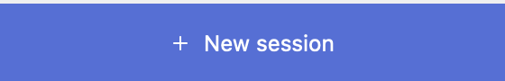
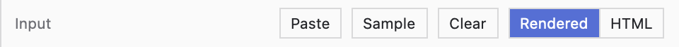
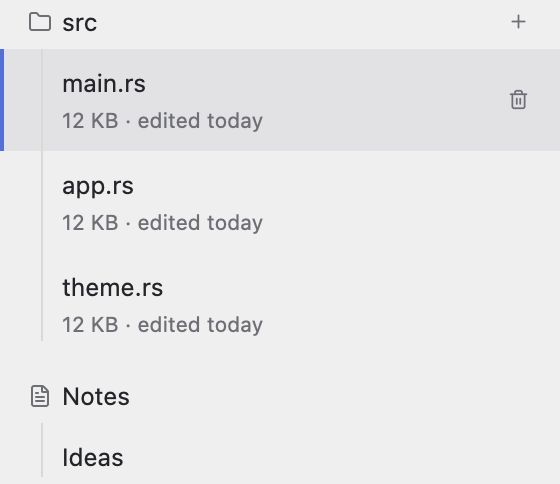

# Buttons

Five kinds, each with one job. Don't style a button yourself and don't add a sixth kind.

| Kind | Where | Call |
|---|---|---|
| Primary (filled, accent) | the one main action: bottom of the sidebar | `kit::primary_button` |
| Icon button (small square) | header, inside rows, toggles | `kit::icon_button` |
| Status button | status bar: New window, Settings | `kit::status_button` |
| Mode toggle | the sidebar's top strip: Tools, Tasks | `kit::mode_toggle` |
| Small text button | a pane's strip: Paste, Copy, Clear, Generate | `kit::small_button` |
| Arm-then-delete | deleting a row, without a dialog | `kit::arm_delete_button` |

## Primary button



**`kit::primary_button(id, icon, label, cx, on_click)`** — the only filled button; one per
screen. In the sidebar's bottom bar add `.flex_1()` so it fills the width.

```rust
kit::primary_button("open", Ico::Plus, "Open", cx,
    Box::new(cx.listener(|this, _, window, cx| this.open_file_dialog(window, cx))))
    .flex_1()
```

## Icon button


**`kit::icon_button(id, icon, tip, active, cx, on_click)`** — 24px square, muted icon, hover
background. `tip` is the tooltip, always given (with the shortcut if there is one:
`"Open files  ⌘B"`). `active = true` paints it in the accent on a light background — a toggle
that is on (the pin in the picture).

```rust
kit::icon_button("pin", Ico::Pin, "Pin", self.pinned, cx,
    Box::new(cx.listener(|this, _, _, cx| { this.pinned = !this.pinned; cx.notify(); })))
```

A button inside a clickable row must not also click the row: start its handler with
`cx.stop_propagation();`.

## Status button


**`kit::status_button(id, icon, tip, active, cx, on_click)`** — full bar height, extra-small
icon, the bar's muted tone; `active` = what it opens is on (accent). Only the window's own
buttons: New window, then the settings gear last. Mode toggles are not status buttons — they sit
over the sidebar (`kit::mode_toggle`, below).

## Small text button



**`kit::small_button(id, label, cx, on_click)`** — a square bordered text button for the
36px strip over a pane (`kit::pane_bar`, `ui-content.md`). Short verbs: "Paste", "Sample",
"Clear", "Copy", "Generate", "Load file…", "Save…".

```rust
kit::small_button("copy", "Copy", cx,
    Box::new(cx.listener(|this, _, _, cx| this.copy_output(cx))))
    .into_any_element()
```

## Delete without a dialog



**`kit::arm_delete_button(id, armed, cx, on_click)`** — a trash icon; the first click arms it
(red, "Confirm delete"), the second deletes. Keep `armed: Option<usize>` in the state; clear it
when anything else is clicked. Pass it as a `list_row`'s `actions` so it shows on hover only.

```rust
let armed = self.armed == Some(i);
kit::arm_delete_button(("del", i), armed, cx, Box::new(cx.listener(move |this, _, _, cx| {
    cx.stop_propagation();
    if this.armed == Some(i) { this.delete_item(i, cx); this.armed = None; }
    else { this.armed = Some(i); }
    cx.notify();
}))).into_any_element()
```

## gpui-kit's Button (menus, pickers, form actions)

When a button opens a menu, or in a form's toolbar (Save / Delete):
`Button::new(id).ghost().xsmall().icon(Ico::X.icon()).label("…")`; variants `.primary()`,
`.danger()`, `.outline()`, `.ghost()`; sizes `.xsmall()`, `.small()`.
`.disabled(bool)` needs `use gpui_kit::component::Disableable as _;`. `.text_color(c)` recolors
label and icon together. A button with a menu: `ui-overlays.md`.

## The one exception to "square"

The composer's Attach / Dictate / Send / Stop buttons float inside the text field, so they are
26px circles (`rounded_full`) with 13px icons: the quiet one with a 1px border and a muted icon,
the filled one in the accent. 26 so the composer stays the header's 36 (at 30 it grew to 44 and
"bulged"). Nothing else in a Bench is round. Code: Bench `src/ui/composer.rs`.

## Mode toggle (over the sidebar)

`kit::mode_toggle(id, icon, "Tools  ⌘3", on, cx, on_click)` in `kit::sidebar_top(vec![…])`:
a 24px square icon button, muted; while its mode is on it is accent on `list_active` and its
tooltip reads "Back  ⌘3". Order left to right = the order of the shortcuts (Tools ⌘3, Tasks ⌘4).
The same strip is on top of every mode's sidebar, so the toggles stay put when you switch.
