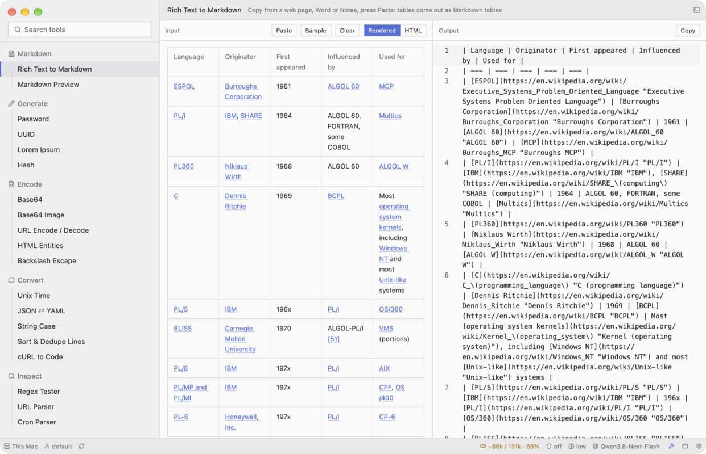

# Content: what the body shows

A thread's block (at its top, `build-subject.md`) or the body shows the thing being worked on. Pick the ready piece:

| The person asks for | Use | Section |
|---|---|---|
| Input → output (a converter, a generator) | two panes with strips | "Two panes" |
| A code / text editor or viewer, line numbers, highlighting, search, undo, several cursors | `EditorState` + `Editor` | "Editor" |
| Rendered Markdown | `TextView::markdown(id, text)` | "Text views" |
| A web page / pasted rich text as it looked | `TextView::html(id, html)` | "Text views" |
| Plain text that can be selected and copied (a message, a log) | Markdown of the escaped text | "Text views" |
| An image | `img(path)` | "Images" |
| Changes to a file | gpui-kit `Diff` | "Diff" |
| A terminal | Bench `src/term.rs` + `src/ui/terminal.rs`, whole | "Terminal" |
| Nothing selected yet | `kit::empty_state` | "Empty state" |
| Images, video, audio, Mermaid, LaTeX, attachments, drag and drop | `build-media.md` | — |

Never write your own text rendering, text buffer or highlighter: a session that did spent
2 hours and 300 tool calls on a broken editor; the recipe below is ~60 lines that compile.

## Empty state


**`kit::empty_state(text, cx)`** — centered, muted: what to do to start ("Open a file to
start", "Copy part of a web page, then press ⌘V"). Never a blank body, never placeholder data.

## Two panes (input → output)



Each pane: a 36px strip (**`kit::pane_bar(title, error, buttons, cx)`** — a muted title, or the
error in red in its place; small buttons on the right) over the content. Between panes a 1px
line. `h_flex` centers its children vertically: give it `.items_stretch()` or the panes shrink
to their content.

```rust
let left = v_flex().flex_1().min_w_0()
    .child(kit::pane_bar("Input", None, vec![
        kit::small_button("paste", "Paste", cx, Box::new(cx.listener(|this, _, w, cx| this.paste(w, cx)))).into_any_element(),
        kit::small_button("clear", "Clear", cx, Box::new(cx.listener(|this, _, w, cx| this.clear(w, cx)))).into_any_element(),
    ], cx))
    .child(div().flex_1().min_h_0().child(Editor::new(&self.input).appearance(false).h_full()));
let right = v_flex().flex_1().min_w_0()
    .child(kit::pane_bar("Output", self.error.clone(), vec![
        kit::small_button("copy", "Copy", cx, Box::new(cx.listener(|this, _, _, cx| this.copy(cx)))).into_any_element(),
    ], cx))
    .child(div().flex_1().min_h_0().child(Editor::new(&self.output).appearance(false).h_full()));
h_flex().size_full().items_stretch()
    .child(left)
    .child(div().w(px(1.)).h_full().bg(theme.border))
    .child(right)
```

The output follows the input as it is typed: subscribe to the input's `InputEvent::Change` and
recompute (`ui-forms.md`). Wrong input → the error in the output strip, the output empty — no
toast. The full working example: Bench's Tools block (`src/app/tools.rs`, `src/ui/tools.rs`, the tools in `src/devtools/`).

## Text views

- **Markdown**: `TextView::markdown(id, text)`, selectable out of the box (the Root draws the
  selection and binds ⌘C). Inside a `div().id(..).flex_1().min_h_0().overflow_y_scroll().px_4().py_3()`.
  Code blocks the size of the text: Bench `src/ui/media.rs` `markdown()` (a `TextViewStyle`
  with a `code_block` refinement).
- **Multi-cursor ⌘D** (select the word, then add its next occurrence, as in Zed): not built into
  gpui-kit's editor (it has ⌘⌥↑/↓ for column cursors). Bench `src/app/ide_tabs.rs`
  `select_next_occurrence`: no selection → select the word under the cursor and remember it;
  with a selection → find the next match after the last one (wrapping), add it as a cursor; a
  changed first selection starts a new run. Bind it in the window's `global_key` only while the
  editor has focus.
- **Code blocks with a header** (an agent's answer): the language on the left, **Copy** on the
  right, the code under it, one 1px frame, no fill. gpui-kit's own block only puts the language
  in its corner and lets `code_block_actions` float over the first line — no header. So split
  closed fences out of the answer before rendering (Bench `src/media.rs` `segments()` →
  `Segment::Code { lang, code }`; an unclosed fence, still streaming, stays text) and draw each:
  ```rust
  v_flex().w_full().border_1().border_color(theme.border)
      .child(h_flex().py_1().pl_4().pr_2().items_center().justify_between()   // = Changed files' line
          .border_b_1().border_color(theme.border).text_xs().text_color(muted)
          .child(if lang.is_empty() { "code".into() } else { lang.clone() })
          .child(h_flex().id(("code-copy", k)).gap_1().px_1p5().items_center().cursor_pointer()
              .hover(|s| s.bg(theme.list_hover).text_color(theme.foreground))
              .child(Ico::Copy.icon().xsmall()).child("Copy")
              .on_click(move |_, window, cx| {
                  cx.write_to_clipboard(ClipboardItem::new_string(code.trim_end().into()));
                  window.push_notification((NotificationType::Success, SharedString::from("Copied")), cx);
              })))
      .child(TextView::markdown(id, format!("```{lang}\n{code}```"))
          .code_block_actions(|_, _, _| div())          // any action hides the corner label
          .style(TextViewStyle::default().code_block(StyleRefinement::default()
              .text_size(rems(0.8125)).line_height(relative(1.5))
              .border_0().bg(transparent_black()))))    // no fill: the frame alone
  ```
  `window.push_notification` needs `use gpui_kit::component::WindowExt as _;`. Full code:
  Bench `src/ui/media.rs` `render_code`.
- **HTML as it looked**: `TextView::html(id, html)` — headings, lists, links, bordered tables,
  images; `<script>`/`<style>` skipped. Bench shows a pasted web page with it
  (`render_rich_input` in `src/ui/tools.rs`), with a `Rendered | HTML` segmented switch.
- **Plain text to select and copy** (a person's message, a log): not `SelectableText` (its
  copy needs keyboard focus, which stays in the composer) — a `TextView::markdown` of the
  escaped text: Bench `src/ui/media.rs` `plain_text`.
- Import: `use gpui_kit::component::text::TextView;`.

## Images

`img(path).size_full().object_fit(ObjectFit::Contain)` in a box of known size. With only max
sizes an image distorts: set `w` and `h` from the real size (`imagesize::size(path)`) scaled to
fit. Bytes you made (decoded Base64, a download): write them to a new file in the app's state
folder each time (the image cache keys on the path), delete the previous one.

## Diff

`DiffFile::parse(patch)` or `DiffFile::unchanged(path, text)`,
`DiffState::new(files, cx).with_context_lines(Some(3))`,
`Diff::new(&state).line_number(true).syntax_highlight(true).header_visible(false)`. A whole-file
view: make the patch yourself with `similar` (`TextDiff::from_lines(a, b).unified_diff()`).
Bench `src/diff.rs`, `src/ui/files.rs`.

## Terminal

Copy Bench `src/term.rs` (a PTY with `portable-pty` + the VT parser `alacritty_terminal`) and
`src/ui/terminal.rs` (the grid drawn by a custom element) whole; don't write one.

**Paths in a terminal open in the mini IDE** (as Warp does, without Warp): ⌘-hover underlines
a link (pointer cursor), ⌘-click opens it — a URL in the browser, a folder as the IDE's tree, a
file in its editor at its `:line` (compiler errors, grep). Recognized: absolute, `~/…`,
relative (`src/main.rs`) and bare file names from `ls` (`wp-config.php`, `nginx.conf`; not
`1.5`). Relative ones are resolved against the terminal's folder: a local shell's own (`lsof -a
-p <pid> -d cwd -Fn`), a server's from the last prompt on screen (`user@host:/var/www$`,
`[user@host /etc]#`), else home. A server answers "file or folder" over ssh. A file under the
tree already open keeps that tree. Code: `term.rs` `link_span`, `prompt_folder`, `cwd`,
`hover_at`; `app/servers.rs` `open_terminal_link`. Notes on the
custom element: `build-custom-render.md`.

## Editor

What `Editor` already does by itself, with no code from you: typing, selection with mouse and
keys, copy / cut / paste, undo ⌘Z / redo ⌘⇧Z, search ⌘F, replace ⌘⇧F, several cursors
(⌘⌥↑ / ⌘⌥↓), word moves (⌥← / ⌥→), indent ⌘] / outdent ⌘[, line numbers, indent guides,
vertical and horizontal scrolling. "Select next occurrence" (⌘D) is not built in: Bench adds it in
`src/app/ide_tabs.rs` (`select_next_occurrence`) — copy that.

Turn on in the builder: `.folding(true)` (fold arrows in the gutter); `.soft_wrap(false)` in a
narrow panel, toggled with `set_soft_wrap(wrap, window, cx)` (Bench: ⌥Z and "Wrap" in the line
under the editor).

**The window must not take the editor's keys.** A window-wide ⌘F that focuses a sidebar search
stole the editor's own find & replace bar for weeks: in `global_key`, when the editor has focus,
return `false` for ⌘F so it reaches the editor (`src/app/keys.rs`, `in_editor`). Same for any
⌃-key you bind (⌃G, ⌃Tab): only while the editor has focus — a terminal needs ⌃-keys.

What Bench adds around the editor, each small (copy the files):
- **The line under it, as in Zed** — `Ln 12, Col 5 · 3 selected · rust · Wrap`, 24px,
  `status_bar` bg, `text_xs` muted: `src/ui/editor_status.rs`. It is its own small view that
  `cx.observe`s the editor (the editor sends no cursor event; observing from the app would repaint
  the whole window on every cursor move). Click "Ln, Col" = go to line.
- **Go to line ⌃G**: a field over the editor's top like ⌘P's; Enter →
  `set_cursor_position(gpui_kit::component::input::Position::new(line - 1, col - 1), window, cx)`
  (0-based, focuses and scrolls). Count lines from `value()` (`matches('\n')`): the rope's
  `len_lines` needs a `LineType` in ropey 2. A line for a file still loading waits in
  `pending_line` and is applied after `set_value` (`src/app/ide_find.rs`).
- **Find in files ⌘⇧F**: a third tab "Search" beside Changes / Files — a field, "N in M
  files", hits grouped by file (Menlo line number + the line, truncated); a click opens the file
  at the line. Smart case (a capital = exact). Local: walk the tree (skip `.git`,
  `node_modules`, `target`…, files > 4 MB, binaries); a server: `grep -rnIF --exclude-dir=…`
  over ssh. Cap 2000 hits.
- **The agent edits the open file** (a tool's `edit.path` = the open path): reload it, cursor
  line kept; with unsaved edits show a warning bar "The agent changed this file" + Reload.
- **⌘W** closes the tab, **⌃Tab / ⌃⇧Tab** cycle tabs, empty ⌘P lists the open tabs first.
- **The tree goes anywhere, like Transmit**: its first row is the folder as a path,
  `… / skills / bench-kit / references` — a click on a folder above moves the tree there (`/` at
  the top); the pencil types a path (`/etc/nginx`, `~/site`). A server's tree too, so a theme
  folder's IDE reaches the nginx config.

**Code into the chat, as in Zed's agent panel** (`src/app/snippets.rs`): ⌘⇧. (or the toolbar's
chat icon) puts the selection — or the cursor's line — over the input as a chip
`main.rs:12–20` (FileCode icon, Menlo, ×). ⌘C in the editor remembers where the text came from;
⌘V in the input with that same text on the clipboard adds the chip instead of bare text. Sent,
each chip becomes `[selection: <path>:<start>-<end>]` + the code fenced with its language; the
sent message shows the chip again (split the blocks out before rendering), and a click opens
the file at those lines. A server file's path is `alias:/path`.

Limits to tell the user honestly (do not try to "fix" them by writing your own editor):
the editor is smooth up to a few MB of text. For bigger files open the first 2 MB (recipe 1
does this) and say that the rest is not shown. A 100+ MB editor is a big project of its own:
ask the user before starting anything like that.

The finished editor in Bench is the mini IDE (`src/app/ide*.rs`, `src/ui/files.rs`); copy from
it rather than assembling the recipes by hand.

### Recipe 1 — code view in the main area

The recipes were written and verified (compiles and runs) in the template app, `templates/app/`
(`MainApp`) — now only the piece library, not a way to start an app. In a Bench the same code goes
on `HermesApp`, and the editor is shown in a subject's block (`build-subject.md`) instead of
`render_body`. The template already has `_subscriptions` — add only `editor` and `file`.

`src/app.rs` — import, field, creation, loading:

```rust
use gpui_kit::component::input::{EditorState, InputEvent, InputState};

pub struct MainApp {
    // ...the template's fields stay (including `_subscriptions`)...
    pub editor: Entity<EditorState>,
    pub file: Option<std::path::PathBuf>,
}

// in MainApp::new, next to `let search = ...`:
let editor = cx.new(|cx| {
    EditorState::new(window, cx)
        .line_number(true)
        .soft_wrap(false)   // long lines scroll sideways
        .searchable(true)   // ⌘F opens the search bar
});
// and in the `Self { ... }` list: `editor, file: None,`

/// Put a file's text in the editor with the right highlighting.
pub fn load_file(&mut self, path: std::path::PathBuf, window: &mut Window, cx: &mut Context<Self>) {
    const MAX: usize = 2 * 1024 * 1024;
    let mut text = match std::fs::read(&path) {
        Ok(bytes) => String::from_utf8_lossy(&bytes[..bytes.len().min(MAX)]).into_owned(),
        Err(e) => format!("Cannot read {}: {e}", path.display()),
    };
    if std::fs::metadata(&path).map_or(0, |m| m.len() as usize) > MAX {
        text.push_str("\n\n[only the first 2 MB is shown]");
    }
    let language = crate::lang::language_for(&path.to_string_lossy());
    self.editor.update(cx, |s, cx| {
        s.set_highlighter(language, cx);
        s.set_value(text, window, cx);
    });
    self.file = Some(path);
    cx.notify();
}
```

`src/ui/mod.rs` — show it in the body (keep the header, sidebar and status bar as they are):

```rust
use gpui_kit::component::input::Editor;

// first lines of render_body:
if self.file.is_some() {
    return Editor::new(&self.editor)
        .appearance(false)   // no border of its own: the panel is the frame
        .h_full()
        .into_any_element();
}
```

The text the user typed: `self.editor.read(cx).value()` (a `SharedString`). To save:
`std::fs::write(path, self.editor.read(cx).value().as_bytes())`. To react to every change,
subscribe like the template does for `search` (create `editor` before the `subscriptions` list):
`cx.subscribe_in(&editor, window, |this, _, ev: &InputEvent, _, cx| { if let InputEvent::Change = ev { ... } })`.

### Recipe 2 — "Open…" with the macOS dialog

```rust
pub fn open_file_dialog(&mut self, window: &mut Window, cx: &mut Context<Self>) {
    let picked = cx.prompt_for_paths(PathPromptOptions {
        files: true,
        directories: false,
        multiple: false,
        prompt: Some("Open".into()),
    });
    cx.spawn_in(window, async move |this, cx| {
        let Ok(Ok(Some(paths))) = picked.await else {
            return;
        };
        let Some(path) = paths.into_iter().next() else {
            return;
        };
        let _ = this.update_in(cx, |this, window, cx| this.load_file(path, window, cx));
    })
    .detach();
}
```

Hook it to a button: `.on_click(cx.listener(|this, _, window, cx| this.open_file_dialog(window, cx)))`
(for example the template's "New" button at the bottom of the sidebar, renamed "Open").

### Recipe 3 — a file from the command line

At the end of `MainApp::new`, build `Self` into a variable first:

```rust
let mut this = Self { /* ...fields... */ };
if let Some(arg) = std::env::args().nth(1) {
    this.load_file(arg.into(), window, cx);
}
this
```

Then `./target/debug/<app> path/to/file.rs` opens the file — also the easy way to check your
work with a screenshot, without clicking anything.

### Recipe 4 — highlighting by extension

New file `src/lang.rs`, and `mod lang;` in `src/main.rs`. These names match the grammars the
template's `Cargo.toml` already enables; do not add grammar crates.

```rust
pub fn language_for(path: &str) -> &'static str {
    let ext = std::path::Path::new(path)
        .extension()
        .and_then(|e| e.to_str())
        .unwrap_or("")
        .to_lowercase();
    match ext.as_str() {
        "rs" => "rust",
        "py" => "python",
        "js" | "mjs" | "jsx" => "javascript",
        "ts" => "typescript",
        "tsx" => "tsx",
        "json" => "json",
        "yaml" | "yml" => "yaml",
        "toml" | "ini" => "toml",
        "md" | "markdown" => "markdown",
        "html" | "htm" | "xml" | "svg" => "html",
        "css" | "scss" => "css",
        "sh" | "bash" | "zsh" | "conf" => "bash",
        "go" => "go",
        "php" => "php",
        "rb" => "ruby",
        "swift" => "swift",
        "java" => "java",
        "kt" => "kotlin",
        "c" | "h" => "c",
        "cpp" | "cc" | "hpp" => "cpp",
        "lua" => "lua",
        _ => "text",
    }
}
```

A fuller version (dotfiles, configs, `#!` lines): Bench `src/lang.rs`.

### Recipe 5 — line and column in the status bar

In `src/ui/statusbar.rs`, in place of the template's item count:

```rust
.child({
    let pos = self.editor.read(cx).cursor_position(); // 0-based
    format!("Ln {}, Col {}", pos.line + 1, pos.character + 1)
})
```
