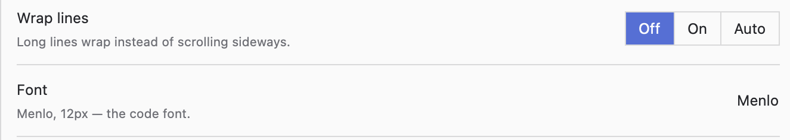

# Forms: fields, settings, choices

## Settings row



**`kit::settings_row(title, hint, control, cx)`** — one setting: the title, a muted one-line
hint under it, the control on the right, a rule below. Stack them in
`v_flex().max_w(px(640.))` inside a `.px_4()` page. The template's `src/ui/settings.rs` has
Appearance (Light / Dark / System, accent, size) ready: keep it, add the app's own rows.

```rust
kit::settings_row("Wrap lines", "Long lines wrap instead of scrolling sideways.",
    kit::segmented("wrap", &["Off", "On", "Auto"], self.wrap as usize, cx, {
        let view = cx.entity();
        Rc::new(move |k, _, cx| view.update(cx, |this, cx| { this.wrap = k; cx.notify(); }))
    }).into_any_element(), cx)
```

## Segmented control

**`kit::segmented(id, labels, chosen, cx, on_pick)`** — pick one of 2–4 short options. Square
cells sharing borders, the chosen one in the accent. Used for settings (Light / Dark / System),
for a tool's modes in the header (Encode / Decode), for views of a pane (Rendered / HTML,
`assets/ui/pane-bar.png`) and for counts (1 / 5 / 10 / 25). More than 4 options, or long
labels → a picker (below).

## Checkbox (yes / no)

```rust
use gpui_kit::component::checkbox::Checkbox;
let view = cx.entity();
Checkbox::new("compact").label("Compact sidebar").checked(self.compact)
    .on_click(move |on, _, cx| { let on = *on; view.update(cx, |this, cx| { this.compact = on; cx.notify(); }) })
```

## One-line field


```rust
// state (in new()):
let name = cx.new(|cx| InputState::new(window, cx).placeholder("Name"));
// view:
Input::new(&self.name)                       // .cleanable(true), .prefix(icon), .small()
// value / set / focus:
self.name.read(cx).value()
self.name.update(cx, |s, cx| s.set_value("text", window, cx));   // emits no Change event
self.name.update(cx, |s, cx| s.focus(window, cx));
// react to typing:
cx.subscribe_in(&name, window, |this, _, ev: &InputEvent, window, cx| {
    if let InputEvent::Change = ev { this.recompute(window, cx) }
})
```

Height comes from the size: Medium (default) = 2rem, `.small()` = 1.5rem. `.h(..)` on an `Input`
does NOT change it — size the neighbours to the input (`rems(2.)`).
A password field: `InputState::new(..).masked(true)`.

## A form (several fields)

Same shape as settings rows, the field on the right taking the width. Bench's server form
(`src/ui/servers.rs`, `render_server_form`) is the example: a muted caption on top
("SERVER · ~/.ssh/config"), rows of `title + hint | Input`, then a bottom row with Cancel
(bordered) and Save (filled, the accent), both `rems(2.)` high.

```rust
let row = |title: &'static str, hint: &'static str, field: &Entity<InputState>| {
    h_flex().gap_4().py_3().items_center().border_b_1().border_color(theme.border)
        .child(v_flex().w(px(220.)).flex_none().gap_0p5()
            .child(div().text_sm().child(title))
            .child(div().text_xs().text_color(muted).child(hint)))
        .child(div().flex_1().child(Input::new(field)))
};
```

Validate on Save; show what's wrong in red in place of the caption, never in a dialog. A form
replaces the body (no modal window): Cancel returns to where the person was.

## Multi-line field and composer

`TextareaState::new(window, cx).auto_grow(1, 10).submit_on_enter(true)` + `Textarea::new(&s)`.
Listen to `InputEvent::PressEnter { shift: false, .. }` (send) and `InputEvent::Change`.
`Textarea::new(&s).appearance(false)` drops its border and background — the composer style
(Bench `src/ui/composer.rs`): a top rule, then a row `min_h(kit::bar_h(cx))` with the field
(no vertical padding of its own, text at the chat's 24) and the 26px round buttons on the right
(`design-layout.md`, "Composer").

## A field that reads as text (inline input)

When a choice is "type a name here or pick something" (Bench's new session: "⧉ Name a group
or 📁 Select folder"), the field has no frame: `Input::new(&s).small().appearance(false)
.prefix(icon)` in a `div().w(px(118.))` sized to its placeholder (measure: a clipped placeholder
or a gap after it both look wrong). Its placeholder then reads like a label; a click puts the
cursor there. Put the alternatives on one line with a muted "or" between them, centered. Bigger text to edit (code, YAML, a note) → the editor
(`ui-content.md`), not a textarea.

## Picker (choose from a list)

In the status bar and in headers a choice is a ghost button with the current value and a menu
of checked items — the icon inside the button so hover highlights both:

```rust
Button::new("model").ghost().xsmall().icon(Ico::Cpu.icon())   // add "cpu" to icons.rs.label(current.clone())
    .text_color(muted)
    .dropdown_menu(move |menu, _, _| {
        items.iter().fold(menu, |m, (name, checked)| {
            let view = view.clone(); let name2 = name.clone();
            m.item(PopupMenuItem::new(name.clone()).checked(*checked)
                .on_click(move |_, _, cx| view.update(cx, |this, cx| this.pick(&name2, cx))))
        })
    })
```

Show the picker only after its list has loaded. In a settings page a long list may use
gpui-kit's `Select` (`gpui-kit-usage.md`, "Select").
