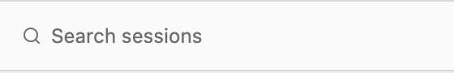
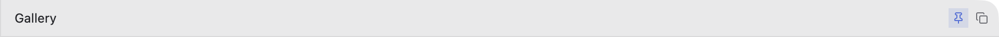
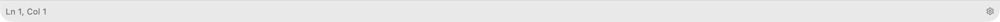
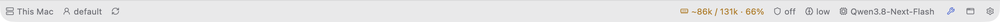

# The frame: window, sidebar, header bar, status bar

Every Bench has this frame and keeps it (Bench's `src/ui/mod.rs`). A new tool doesn't get a
frame of its own: it is a subject — a sidebar group, a live block at the top of its thread, the
conversation under it (`build-insert.md`). Never remove the sidebar, the header or the status bar.

Picture: `assets/gallery.png` (the piece gallery), `assets/ui/tools-mode.png` (Bench's Tools block).

```
┌ sidebar 280px ─────────┬ main ──────────────────────────────────────────┐
│ (traffic lights) 📂 + ◧ │ header_bar 36px: title ........... icon_buttons │
│ search band (36)       │ [tab_strip 36px, if the view has tabs]          │
│ ─────────────────────  │                                                 │
│ group_header           │ body: a thread (its block on top) / settings    │
│ │ list_row             │       / empty_state                             │
│ │ list_row             │                                                 │
│ group_header           │                                                 │
│ ─────────────────────  │                                                 │
│ primary_button (36)    │ composer (36)                                   │
├────────────────────────┴─────────────────────────────────────────────────┤
│ status bar 28px: facts .............................. pickers · ⧉ · ⚙ │
└──────────────────────────────────────────────────────────────────────────┘
```

**One height for every bar: the header's 36.** The search band, the bottom button, a composer,
a list's tag strip: all 36 with their rule, and every rule that crosses the window is one line
(the search band's top rule = the header's bottom rule; the bottom button's top edge = the
composer's top rule). The user checks this to the pixel.

The title bar is transparent: the sidebar starts with a 35px strip beside the traffic lights
(`kit::sidebar_top`) holding its icon buttons on the right (Bench: Open folder, "+" New session
⌘N, Hide sidebar ⌘\\ — `render_sidebar_top`),
the header sits at the top of the main column. Resizable split:
`h_resizable("layout").child(resizable_panel().size(px(280.)).size_range(px(200.)..px(480.)).child(sidebar)).child(resizable_panel().child(main))`
(wrap it in a `div().flex_1().min_h_0()` — the group itself takes no styling).

## Sidebar: top strip, search band, list, one button at the bottom



The search and the button are **bands from edge to edge**, not controls floating in a padded
bar: the search has rules above and below and the content's background between, with no frame
of its own (it *is* the divider), its magnifier right over the group icons; the bottom button
fills its whole bar (no rule, no margin), its top edge level with the composer's rule (Bench has
no bottom button: a new chat is the "+"). Every sidebar variant (the list, the IDE's tree) starts
with the same top strip, so its icons never jump.

```rust
v_flex().size_full().bg(theme.sidebar)
    .child(kit::sidebar_top(vec![                          // beside the window buttons, 35
        kit::mode_toggle("new-item", Ico::Plus, "New session  ⌘N", false, cx,
            Box::new(cx.listener(|this, _, _, cx| this.new_session(cx)))).into_any_element(),
    ]))
    .child(kit::search_band(&self.search, cx))             // 36 with its two rules
    .child(v_flex().id("list").flex_1().min_h_0().overflow_y_scroll().py_1().children(rows))
    .child(kit::bottom_bar(kit::primary_button("new", Ico::Plus, "New", cx,
        Box::new(cx.listener(|this, _, _, cx| this.new_item(cx)))), cx))   // bar_h + 1
```

`kit::sidebar_top`, `mode_toggle`, `search_band`, `bottom_bar` are in `templates/app/src/ui/kit.rs`
(Bench: `render_sidebar_top` and `search_band` in `src/ui/mod.rs`).

Search state: `InputState::new(window, cx).placeholder("Search …")`, filter on
`InputEvent::Change` (keep the lowercase query in a field, `cx.notify()`).

## Header bar



**`kit::header_bar(title, right, cx)`** — 36px over the main area: the title (medium, truncates),
then `right`, an `h_flex().gap_1()` of `kit::icon_button`s (or `div().into_any_element()`).

```rust
let right = h_flex().gap_1()
    .child(kit::icon_button("pin", Ico::Pin, "Pin", self.pinned, cx,
        Box::new(cx.listener(|this, _, _, cx| { this.pinned = !this.pinned; cx.notify(); }))))
    .into_any_element();
kit::header_bar(self.title(), right, cx)
```

What goes in the header, in this order: the title; a muted one-line hint (`flex_1().truncate()`,
Bench Tools); the item's choices as a `segmented` control; icon toggles with a tooltip that
names the shortcut ("Open files  ⌘B"); window-level buttons last. Item-specific actions that are
rare go into the item's "⋯" menu, not the header.

## Status bar




28px, `bg(theme.status_bar)`, `border_t_1`, `text_xs`, everything in one muted tone.
- Left: facts — where and who (`kit::status_text("This Mac")`, "Ln 3, Col 9", "12 items").
  Facts are not controls.
- Right: live readouts and pickers (`ui-forms.md`, "Picker"), then only the window's own
  buttons: New window, then Settings ⚙ last — each a
  `kit::status_button(id, icon, tip, active, cx, on_click)`. Nothing else goes in that
  corner ("the corner keeps only New window and Settings"); the sidebar's own buttons sit in its
  top strip.
- Nothing goes into the status bar that the person didn't ask for. Hide a picker until its data
  has loaded — never show "—" or a default pretending to be real.

```rust
h_flex().h(px(28.)).flex_none().w_full().bg(theme.status_bar)
    .border_t_1().border_color(theme.border).text_xs().text_color(muted)
    .child(kit::status_text(format!("{} items", self.items.len())))
    .child(div().flex_1())
    .child(kit::status_button("settings", Ico::Settings, "Settings", settings_on, cx,
        Box::new(cx.listener(|this, _, _, cx| this.toggle_settings(cx)))))
```

## Bars that face each other

**`kit::bar_h(cx)`** = `font_size × 2.5` = 35 at the 14px font: the header's 36 less the one
rule a bar draws. A bar with one rule is `bar_h + 1` (the bottom button, a composer with its
top rule, a "+ New item" row); the search band with two rules is `bar_h + 1` too; a strip under
the header (the Tasks tag strip) is `min_h(bar_h)`. Header 36px, status bar 28px, pane strips
36px. What sits inside a bar is sized to fit it, never the reverse: the composer's round buttons
are 26 (were 30 — they made the bar 44 and the user saw it "bulge"). Use rems next to rem-sized
controls: fixed `px` heights drift apart at the S/L font sizes.

## Subjects, not modes

There are no modes. Tasks, Servers, Files, Browser, Tools and the project groups are sidebar
groups; a click opens the latest thread about that subject (or a new one), its live block on
top (`src/app/subjects.rs`, `render_chat` in `src/ui/chat.rs`). ⌘1 chats, ⌘2 this Mac's terminal,
⌘3 the current tool, ⌘4 Today's tasks (`src/app/keys.rs`). Recipe: `build-insert.md`.
