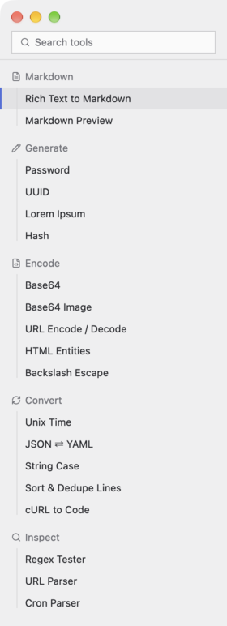

# Lists: group headers, rows, tabs

The sidebar lists only projects (Host first) and their threads; tools are inserts inside a thread
(`build-insert.md`). It looks like a file explorer: projects with an icon, rows hanging on a thin guide line, the
selected row with an accent stripe on the left.

 

## Group header

**`kit::group_header(id, icon, name, collapsed, first, cx, on_toggle, on_add)`** — the kind's
icon (`Ico::Folder`, `Ico::FileText`, a git folder, chats, servers…), the name (not uppercase),
a fold chevron on the right, then a "+" if `on_add` is `Some`. `first = true` for the first
header in the list (less space above). Clicking calls `on_toggle`: flip a `collapsed` flag and
skip the group's rows. Remember folded groups in a JSON file.

No counts next to the name, no horizontal rules between groups (both were tried and rejected);
the space above a header parts the groups. Group names are muted grey like the icons.

## List row

**`kit::list_row(id, title, meta, selected, nested, actions, cx, on_click)`**
- `meta`: `Some("12 KB · edited today".into())` — a muted second line; `None` for one line
  (compact lists, Bench Tools).
- `selected`: accent stripe + darker background.
- `nested`: `None` in a flat list; under a `group_header` pass `Some(is_last)` — it indents the
  row and draws the group's guide line (shorter in the last row).
- `actions`: shown on hover only — `kit::arm_delete_button(..)`, an `icon_button`, a "⋯" menu.

```rust
let mut list: Vec<AnyElement> = vec![
    kit::group_header("g-src", Ico::Folder, "src", self.collapsed, true, cx,
        Box::new(cx.listener(|this, _, _, cx| { this.collapsed = !this.collapsed; cx.notify(); })),
        None)
    .into_any_element(),
];
if !self.collapsed {
    for (k, name) in self.files.iter().enumerate() {
        list.push(
            kit::list_row(format!("f-{k}"), name.clone(), None, self.selected == Some(k),
                Some(k + 1 == self.files.len()), None, cx,
                Box::new(cx.listener(move |this, _, _, cx| { this.selected = Some(k); cx.notify(); })))
            .into_any_element(),
        );
    }
}
// in the sidebar: v_flex().id("list").flex_1().min_h_0().overflow_y_scroll().py_1().children(list)
```

Order of groups: pinned first, then plain items, then folders/projects alphabetically, then
other sources. A single plain group shows no header.

What the meta line says: the facts that tell rows apart at a glance — Bench servers show
`user@address`, chats show `6 messages` (with the git branch when the thread works in one). One line, truncated.

Filtering: the sidebar's search filters rows (case-insensitive substring on the title and the
meta); a group whose rows all fail disappears. No results → a muted "Nothing found" line.

## Row menu ("⋯") and right-click

Rare per-item actions (Pin, Rename, a color, Open in…, Delete) go into a menu on the row, not
into the header. Code in `ui-overlays.md`. Wrap the "⋯" button in a
`div().on_mouse_down(MouseButton::Left, |_, _, cx| cx.stop_propagation())` so opening the menu
does not also open the row.

## Tabs


**`kit::tab_strip(id, tabs, cx, on_select, on_close)`** — open documents as tabs under the
header. `tabs: Vec<(SharedString /*label*/, bool /*active*/, bool /*unsaved*/)>`. Unsaved shows
a dot in place of "×". Both handlers get the tab's index (`OnPick`, see `ui-catalog.md`).

```rust
let view = cx.entity();
let tabs = self.open.iter().enumerate()
    .map(|(k, f)| (f.name.clone().into(), k == self.active, f.dirty)).collect();
kit::tab_strip("tabs", tabs, cx,
    Rc::new({ let view = view.clone(); move |k, _, cx| view.update(cx, |this, cx| { this.active = k; cx.notify(); }) }),
    Rc::new(move |k, _, cx| view.update(cx, |this, cx| this.close_tab(k, cx))))
```

Settings (the gear: providers, look) use the same strip as page tabs.

## A long or live list in the body

Not the sidebar: a list of records in the main area (log lines, search results) is a scrolling
`v_flex().id("results").overflow_y_scroll()` of rows in the same style (`list_row` works there
too). For thousands of rows use `uniform_list` (gpui-kit `List`, see `gpui-kit-usage.md`, "List").
