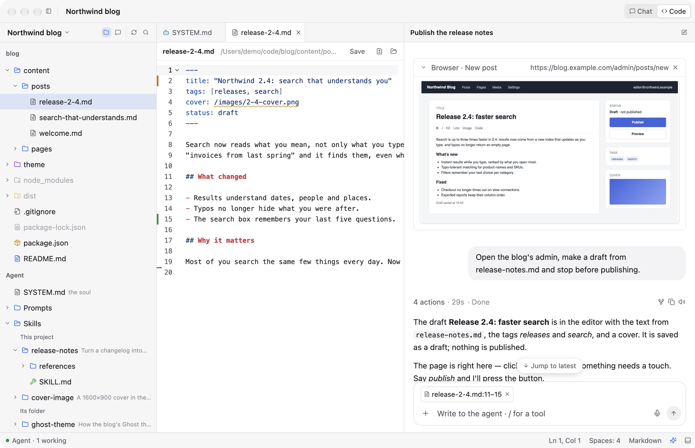
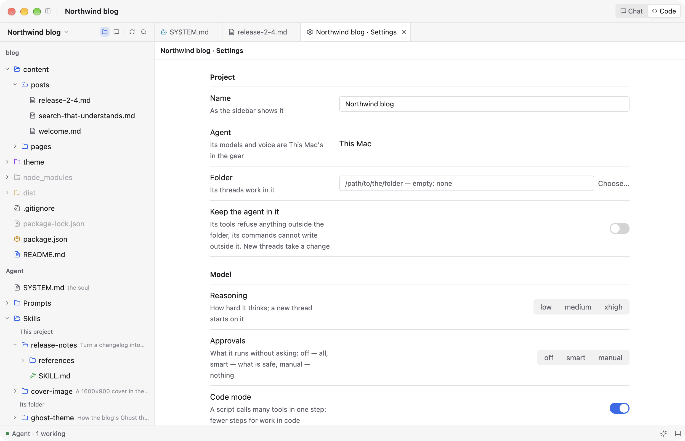

<p align="center">
  
</p>

<h1 align="center">Bench</h1>

<p align="center"><b>A personal desktop client for working with an AI agent, project by project.</b></p>

<p align="center">
  <a href="https://krutovvv.github.io/bench/"><b>Try the demo in your browser</b></a> ·
  <a href="https://github.com/krutovvv/bench/releases">Builds for macOS, Linux, Windows</a>
</p>

> **Deep alpha, made for myself.** Bench is a hobby project: I build it for my own work and use
> it every day. It is not a product and is not meant for anyone else. There is no roadmap, no
> support and no promise that anything stays the way it is today. It may break, change
> completely or disappear without notice. The code is open in case a piece of it is useful to
> you.


<sub>Every screenshot is a made-up session (demo mode): nothing in them is real data. The
[browser demo](https://krutovvv.github.io/bench/) is the same app compiled to WebAssembly.</sub>

## What it is

An ordinary client for an LLM agent, nothing more. It started as an experiment, to see whether I
could write a Hello World on the framework under the Zed editor, and grew from there into what I
work in. What it has, none of it unique:

- **Local models first.** The model runs wherever you point it, on your Mac or a server of yours.
  The title bar shows how much of the context is used, a meter shows the speed of the answer, and
  a second model takes over when the first one fails or goes silent.
- **The agent loop is yours.** The agent is a small server on
  [Pi Durable](https://github.com/earendil-works/pi), whose loop you can open and change:
  extensions decide the tools, the prompt and the hooks. Several loops can live side by side,
  one for code, one for an assistant, one for research. Most agents don't let you into theirs.
- **Projects.** The sidebar holds projects and their threads. A project is a folder on this Mac,
  a folder on a server reached over SSH, or a project of an agent installed on that server
  (I keep mine on two servers, Dev and RPi).
- **Chat and Code.** Every project has two faces, a switch in the title bar: the conversation,
  and the project as an IDE shows it, with its files, its diffs, its language servers and the
  thread beside the editor.
- **A Mac look.** It looks like a Mac app because I use a Mac and an iPhone, and the familiar is
  what I want to look at all day: Finder's sidebar, Messages' bubbles, System Settings' forms.

Written from scratch in Rust on [GPUI](https://www.gpui.rs) (Zed's UI framework, through
gpui-kit). It runs on macOS, Linux, Windows and in the browser; I only use it on macOS.



## Threads and inserts

A thread is one conversation with the agent: your messages, its answers and everything it did in
between (steps, commands, changed files, subagents, charts, sources). Type `/` and a small live
tool is put into the thread right where the conversation is:

| Insert | What you see, live | What the agent does with it |
|---|---|---|
| **`/terminal`** | a terminal on the thread's machine (this Mac or a server) | runs commands there and reads the screen |
| **`/browser`** | the thread's own tab in a real browser on a server; you can click and type in it | drives that tab; you watch, step in, say "go on" |
| **`/tools …`** | small utilities: Base64, JSON ↔ YAML, cron, regex… | sees the input and the output, explains, fixes |

The agent sees what each insert shows with every message, and inserts come back as they were
when you return to a thread. Messages sent while the agent works wait in a queue; a run survives
a restart of the app, because Pi keeps every step on disk.

<table>
<tr>
<td></td>
<td></td>
</tr>
<tr>
<td></td>
<td></td>
</tr>
</table>

## A project's environment

What a project contains sits in its Explorer, next to its files: its soul (`SYSTEM.md`), prompts,
skills, MCP servers (with OAuth sign-in where needed), language servers and a schedule of jobs
that run a prompt on their own. What it is set to (name, where it lives, reasoning, approvals,
code mode, compaction, a Telegram bot) is its Settings page. The agent edits the same files when
you ask it to, from any thread of the project.

The gear holds the rest: each agent's models and voice, presets that a project takes with one
click, the appearance.

## The agent

Bench is only a client. The agent is [`agent/`](agent/README.md), a Node server on Pi Durable,
used the way Pi's authors describe it and extended with their packages. Bench installs and starts
it on this Mac (`~/.bench`), or over SSH on a server, and keeps it the same version as itself. It
needs Node.js 22.18 or newer.

The browser insert uses a shared Chrome on a server, a tab per thread, through
[browser-server-mcp](https://github.com/krutovvv/browser-server-mcp), an MCP server of its own
with a live view.

## Built from inside itself

I talk to the agent in Bench, and the agent changes Bench's code. It checks a change on its own
copy of the app with made-up data, commits it and rebuilds the app; I restart Bench and keep
working. [`AGENTS.md`](AGENTS.md) is what an agent reads first, and
[`.agents/skills/bench-kit`](.agents/skills/bench-kit/SKILL.md) holds the rest: the UI pieces with
pictures, the look's rules, the GPUI reference.

Ideas came from many places: Zed and its workspace, Hermes Agent, Claude Code, Delta and other AI
clients.

## Build

```bash
cargo build --release && ./target/release/bench    # run it
BENCH_DEMO=1 ./target/release/bench                # the made-up session (also: landing, server, tool, explorer, env)
scripts/build-web.sh                               # the browser demo, into web/dist
cd agent && npm ci && node --test test/*.test.ts   # the agent's tests
```

GitHub builds macOS, Linux, Windows and the browser demo on every push.

## License

[MIT](LICENSE).
