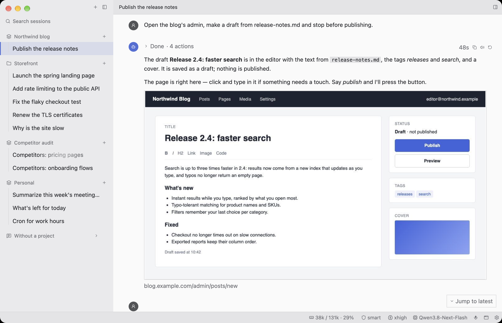
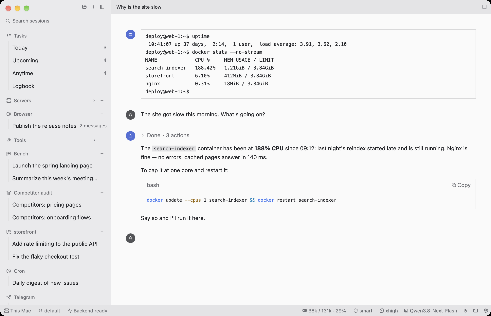
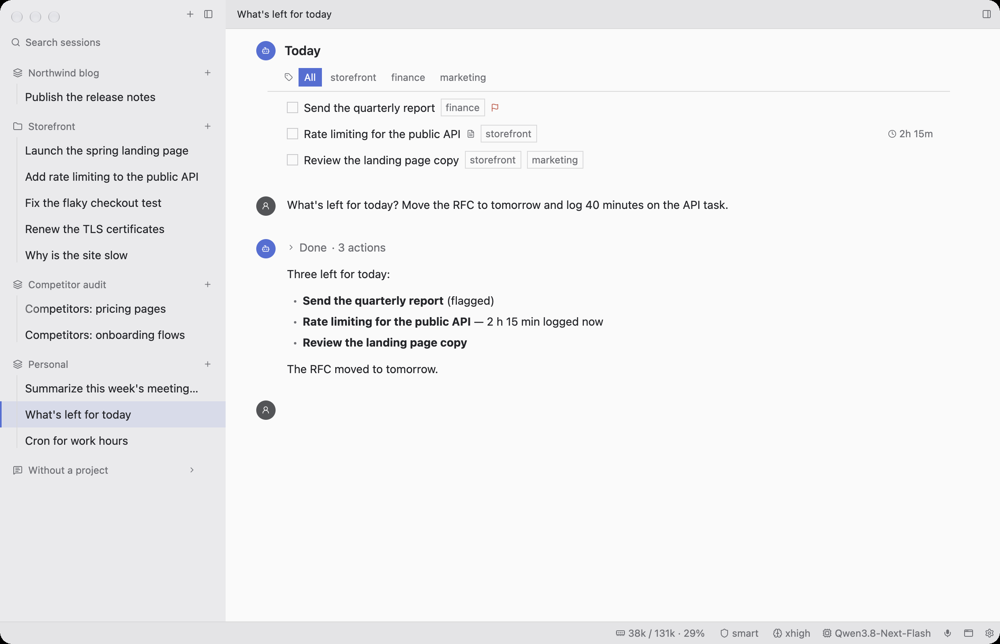
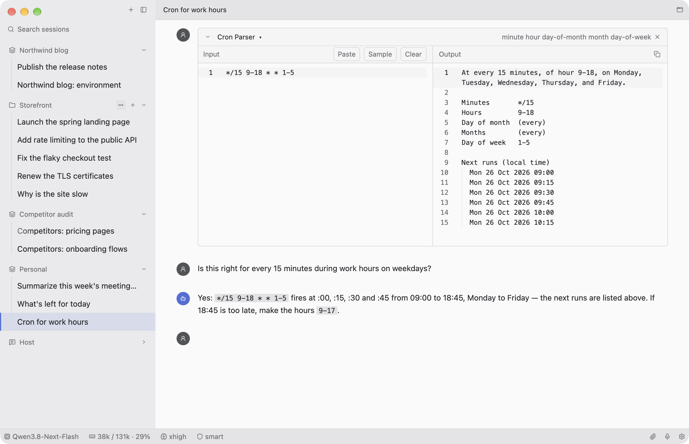
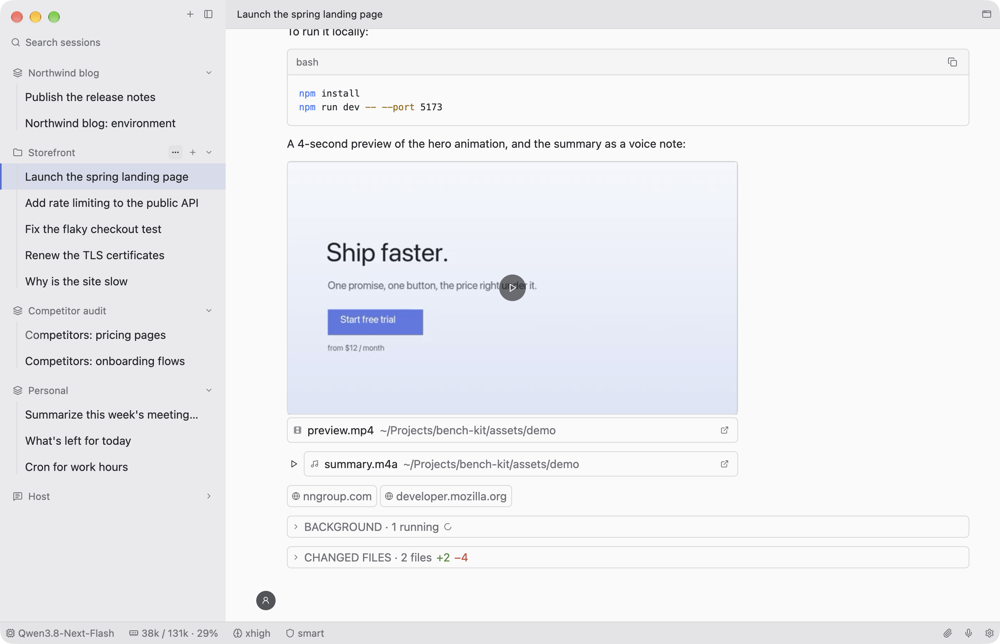

<p align="center">
  
</p>

<h1 align="center">Bench</h1>

<p align="center"><b>A workbench for working with an AI agent: an open, native, thread-centric app where the tools you need are put right into the conversation.</b></p>

<p align="center">
  <a href="https://krutovvv.github.io/bench/"><b>Try the demo in your browser</b></a> ·
  <a href="https://github.com/krutovvv/bench/releases">Download for macOS, Linux, Windows</a>
</p>



<sub>A made-up session (demo mode): nothing in these screenshots is real data. The
[browser demo](https://krutovvv.github.io/bench/) is the same app compiled to WebAssembly —
click through the threads in the sidebar.</sub>

## What it is

Bench is a desktop app for one thing: doing your work together with an AI agent. The
conversation with the agent is the unit of work, not a side panel of an editor.

**Built with:**
- [GPUI](https://www.gpui.rs) (Zed's open-source UI framework, through gpui-kit) and Rust, written
  from scratch: native and fast, on macOS, Linux, Windows and in the browser (WebAssembly);
- [Pi Durable](https://github.com/earendil-works/pi) for the agent (`agent/`, Node.js): durable
  conversations, tools, extensions, scheduled tasks, MCP;
- grammY for Telegram.

A workbench, not a chat window: you bring the tools you need for this job to the conversation,
and the agent works with them alongside you.

## The thread is a document

A thread is not a list of chat bubbles. It is a **document** made of two kinds of things:

- **messages**: yours and the agent's, with everything the agent did in between (steps,
  commands, changed files, subagents, pictures, sources);
- **inserts**: small live tools you put into the thread by typing `/`, right where the
  conversation is.

An insert is part of what you say. Type `/terminal` and the project's terminal appears in the
thread, live. Ask "why is the site slow?" and the agent sees what that terminal shows. It runs
commands there, and you see them run in the same terminal. A thread can hold several inserts.
Every `/` adds a new one; the thread never switches mode or gets renamed for it. Come back to a
thread tomorrow and its inserts are where you left them, in the same state.

| Insert | What you see, live | What the agent does with it |
|---|---|---|
| **`/browser`** | this thread's own tab in a real browser on a server; you click and type in it | drives that tab (Playwright), only that tab; you watch, step in, say "continue" |
| **`/terminal`** | a terminal on the project's machine (this Mac or its server), as tall as its text | runs commands there and reads the screen |
| **`/tasks`** | Today, Upcoming, Anytime, Logbook, a click apart; one list for everything, a project is a tag (in a project it opens filtered by it) | adds, moves, completes, sums the hours ("how long did I work for this client in October?") |
| **`/tools`** | Base64, regex, cron, JSON, a web page as Markdown… with input and output | explains, fixes, works with what's in it |

When something needs a form (a new task, an MCP server's settings), the form
appears as a card in the thread, under the insert that asked for it, not in a settings window.

## Projects

The sidebar holds only **projects** and their threads. A project is whatever you work on: a
client, a site, a codebase, a kind of work. It may have a folder on disk (then the threads work
in it), and it may live on a server (its agent runs
there, over SSH).

Each project carries its **environment**, the way Claude Code reads a repository's setup:

- its soul (what the project is and how to work in it);
- its MCP servers (with OAuth sign-in where a server needs it);
- its skills and prompts;
- its Telegram bot;
- its schedule (jobs that run a prompt in a new thread on their own).

You edit it in the thread too: each part is a block in the project's environment thread, and a
change opens as a card under that block. **Host** is this computer's own project, always at the top,, for
installing, building and looking after it. A server added as a project (**Dev**, **RPi**) works entirely there: its agent, threads, terminal, files, skills, MCP servers and
schedule all live and run on that server.

The only classic settings are behind the gear: model providers and the look.

## How it differs

- **The conversation is the workspace.** No modes, no panels per job, no separate apps for the
  terminal, the files, the tasks, the browser. They come to the thread.
- **The agent sees what you see.** Each insert tells the agent what it shows with every message
  (the terminal's last lines, the open file, the tool's input and output) and gives the agent a
  tool to act on it.
- **You can always take over.** The browser tab, the terminal and the editor are live and yours
  too: fix a word, sign in, tick a box, then let the agent go on.
- **Durable.** Pi keeps every step on disk. A turn survives a crash or a restart, scheduled jobs
  and Telegram answers keep running with Bench closed, and inserts come back as they were.
- **Messages queue.** Send while the agent works and your message waits in the thread's queue.
  Above the composer each waiting message can be sent now or taken back.
- **Open and local.** Your data lives on your machine (`~/.bench`): providers you choose,
  including local models; MIT-licensed code.

<table>
<tr>
<td></td>
<td></td>
</tr>
<tr>
<td></td>
<td></td>
</tr>
</table>

## The agent

Bench is a client. The agent is [`agent/`](agent/README.md), a small Node server on Pi Durable,
used the way Pi's authors describe it and extended with their packages and popular ones. Bench
installs and starts it on this Mac (`~/.bench`), or over SSH on a server. It needs Node.js 22.18
or newer.

The agent keeps everything in Pi's own terms:

- **an insert** is an entry in the conversation's transcript, where you put it, plus its live
  state (which host, folder, list or tab) in a document of the conversation, changed in commits.
  Bench changes it through the agent and takes the agent's answer as the truth;
- **the system prompt** is Pi sections, among them a line per insert saying what it is and
  which tool acts on it. A section is resent only when it changes, so the provider's prompt
  cache stays warm;
- **the queue** is Pi's inbox;
- **a scheduled job** is a durable Pi task that sleeps until its time;
- **subagents** are child conversations owned by the tool call that started them.

The browser inserts use a shared Chrome on a server: a tab per thread, driven through the
Playwright MCP, and watched through a small gateway. The server is a project of its own,
[browser-server-mcp](https://github.com/krutovvv/browser-server-mcp): an MCP server any agent can use, with a live view Bench supports. Each person gets their own key and no SSH is
needed. Frames arrive at 2 per second at most, and only while someone is watching.

## Developed from inside itself

I talk to the agent in Bench, and the agent changes Bench's code. Every commit becomes its own
app next to the one I'm running. I try it and switch over when it's good; earlier builds stay
for rolling back. [`AGENTS.md`](AGENTS.md) is what an agent reads first. The skill in
[`.agents/skills/bench-kit`](.agents/skills/bench-kit/SKILL.md) holds the rest: the insert
recipe, the UI pieces with pictures, the look's rules, and the GPUI reference.

## Build

```bash
cargo build --release && ./target/release/bench    # run it
BENCH_DEMO=1 ./target/release/bench                # the made-up session (also: tasks, server, tool, env)
scripts/build-web.sh                               # the browser demo, into web/dist
cd agent && npm ci && node --test test/*.test.ts   # the agent's tests
```

GPUI runs on macOS, Linux, Windows and in the browser; GitHub builds all of them on every push.
I use Bench on macOS: notifications talk to macOS directly, the rest is the same Rust
everywhere.

## License

[MIT](LICENSE).
