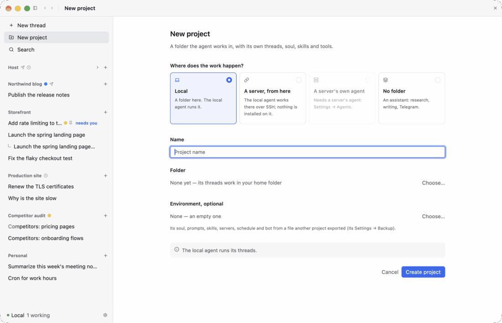
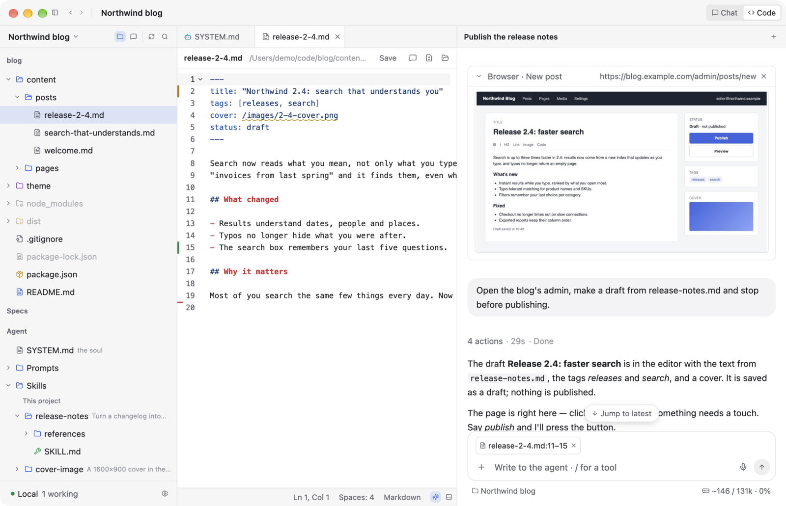

<p align="center">
  
</p>

<h1 align="center">Bench</h1>

<p align="center"><b>A first-class agent interface for local models.</b><br>
The experience of the best coding-agent apps, on a model you run and control.<br>
And a starting point: fork it, and have your agent build what you need into it.</p>

<p align="center">
  <a href="https://github.com/krutovvv/Bench/releases/latest"><b>Download</b></a> (macOS, Linux, Windows) ·
  <a href="https://krutovvv.github.io/Bench/"><b>Try the demo in your browser</b></a>
</p>

<p align="center">
  
</p>

> **Alpha.** Everything works and I use it every day, but it is not yet as fast or as reliable
> as I want it to be, especially with remote projects. Expect rough edges and changes.

## Why

Local models are strong now. What they lack is an interface. The commercial agent apps are
polished down to the details: the agent's steps fold away neatly, voice input just works, a small
model helps the big one along, the window is fast. For a local model I could not find a single UI
that does this well. And even a good one may not fit the way you work.

So Bench is two things:

- **An agent UI for local models, done properly.** Fast (native, in Rust), carefully worked out,
  pleasant to look at, and built around a model under your own control: your workflow does not
  depend on anyone's servers or pricing.
- **A boilerplate for your own interface.** Bench ships with its specs (a `SPEC.md` beside every
  module) and skills for coding agents (`AGENTS.md`, `.agents/skills/`), so an agent can find its
  way around the code from the first minute. A feature is missing? Fork the repository, point your
  coding agent at it, and ask for the feature. Bench itself is built this way: by vibe coding, from
  inside itself.

It is also an example: you can vibe-code an interface for yourself that is fast, good-looking and
shaped around your own work.

## What Bench is, in four lines

1. **Just a client.** Bench talks to models over an API: first of all local ones, on your Mac or a
   machine in your network (any OpenAI- or Anthropic-compatible API), or a provider you have a key for.
   There are no subscriptions, no accounts and nothing of ours in between.
2. **Made for code.** You can use it for deep research or writing, but everything in it is built
   around working on code: vibe coding, reviewing what the agent did, fixing it by hand.
3. **Work is organized in projects.** A project lives on this machine or on a remote one; for you
   it is the same.
4. **The agent can live anywhere.** On your Mac, or on a server on its own, so Bench becomes a
   control center for several machines.

All screenshots below are a made-up demo session: nothing in them is real data.

## Projects

The project is the smallest unit in Bench. The sidebar holds projects, and each project holds its
threads. A project says **where its work happens**:

- **Local**: a folder on this Mac; the local agent works in it.
- **A server, from here**: a folder on a server you reach over SSH. The agent on your Mac works
  there; nothing is installed on the server.
- **A server's own agent**: the agent is installed on the server and runs there by itself. Your
  Mac is not needed: close the laptop and the work goes on.
- **No folder**: an assistant for research, writing, Telegram.

A project can **keep the agent in its folder**: its tools refuse paths outside it, its commands
cannot write outside it. Or you can give the agent the whole machine.

Each project has its own environment, and nothing of it leaks into another project: its soul
(`SYSTEM.md`), prompts, skills, MCP servers, language servers, a schedule of jobs and a Telegram
bot.


## Chat and Code

Every project has two views, switched in the title bar.

**Chat** is an ordinary chat with the agent. The agent's work does not flood it: all its actions
fold into one line ("8 actions · 3:17 · Done"), and while it works you see only the text of what it
is doing right now. Unfold the line to see every step.

<table>
<tr>
<td></td>
<td></td>
</tr>
</table>

**Code** is the same project as a built-in IDE: the file tree, documents in tabs, language servers,
lines changed since the last commit, and a chat beside the editor. Look at what the agent did in
the chat, select lines and send them to it, point it at an exact place in an exact file, or just
fix the code yourself and save.



Because a project can live on a server, this works the same for a remote folder: open a server's
project (even production, if you dare) and work with it, with the agent or by hand, as if it were
on your computer. No separate editor, no copying files back and forth. It saves a lot of time and
lets you keep many more projects going at once.

## Reviewing what the agent did

- **Changed files.** Under each answer, the files that turn changed, with their line counts. A
  click shows a file's diff in place; one more opens it in the Code view.
- **A built-in reviewer.** "Review" at the head of the block has an independent reviewer read the
  turn (what you asked, the plan, what the agent says it did, and the diff) and leave notes on the
  exact lines. "Send to the agent" hands them back as review comments.

<table>
<tr>
<td></td>
<td></td>
</tr>
</table>

## The agent's settings, per project

- **An evaluator.** A small, fast model (a System One server, Jev's API; a main one and a
  fallback in the gear) decides where the main model spends its steps: it refuses a repeat of a
  call that already failed, trims long results to what the request needs, checks the course on long
  runs. Code mode scripts ask it too, for the many small decisions over the data they fetch.
- **Compaction.** When a long conversation is summarized, as a share of the model's window.
- **A step limit** for long sessions: past it the agent stops and answers with what is done.
- **Reasoning and approvals**: how hard it thinks, and what it may run without asking.

The model itself is the gear's, one for every project, with a fallback that takes over when the
main one fails or goes silent.


## Telegram

Give a project a Telegram bot and its chats become that project's threads. You can talk to your
project from your phone: ask what the agent is doing, give it a task, read the answer.

## Many machines, one window

Add a server in Settings → Agents and Bench installs the agent there over SSH, starts it and keeps
it at the same version as itself. Each server's agent has its own projects, models and Telegram
bot, and runs on its own. Bench becomes a control center: you add as many machines as you need and
check on them, watch them and update them when you want.

## Commands in the chat

Type `/` in a thread and a small live tool is put right where the conversation is. The agent sees
what it shows with every message and can act on it.

| Command | What you see | What the agent does with it |
|---|---|---|
| **`/terminal`** | a terminal on the thread's machine (this Mac or a server) | runs commands there and reads the screen |
| **`/browser`** | the thread's own tab in a browser on a server; you can click in it | drives the tab while you watch and step in |
| **`/tools …`** | small utilities: Base64, JSON ↔ YAML, cron, regex… | sees the input and the output, explains, fixes |


Messages you send while the agent works wait in a queue. A run survives a restart of the app,
because every step is kept on disk.

## What it is built on

- **[Pi Durable](https://github.com/earendil-works/pi)** runs the agent: a small Node server in
  [`agent/`](agent/README.md), with Pi used unmodified and extended with its own packages. Every
  step of a conversation is durable.
- **[GPUI](https://www.gpui.rs)**, the UI framework of the [Zed](https://github.com/zed-industries/zed)
  editor, through gpui-kit. Bench is written from scratch in Rust.
- **The look is macOS's**: Finder's sidebar, Messages' bubbles, System Settings' forms.
- **The structure and logic** come from Claude Code's desktop app and from Zed's workspace (its
  docks, panels and tabs).

## Make it yours

If Claude Code, by its creator's account, [largely writes itself](https://newsletter.pragmaticengineer.com/p/how-claude-code-is-built),
it can write the interface you need for your own models too. Bench is what that looked like for me.
Take it as a starting point: shape it with a strong coding agent, then do the actual work on a local
model you control.

Bench is built from inside itself: I talk to the agent in Bench, and it changes Bench's code,
checks the change on its own copy of the app with made-up data, commits it and rebuilds the app.
Everything that loop needs is in the repository, so it works in your fork too:

- [`AGENTS.md`](AGENTS.md): what an agent reads first: how to work here and where to look;
- [`.agents/skills/bench-map`](.agents/skills/bench-map/SKILL.md): the file for each common change;
- `SPEC.md` beside every module: why it is built the way it is, linked into one tree;
- [`.agents/skills/bench-kit`](.agents/skills/bench-kit/SKILL.md): the UI pieces with pictures,
  the look's rules, how to check a change with a screenshot.

Fork, open it with your coding agent (or in Bench itself), describe the feature.

## Build

```bash
cargo build --release && ./target/release/bench    # run it
BENCH_DEMO=1 ./target/release/bench                # the made-up session (also: landing, server, explorer, env)
scripts/build-web.sh                               # the browser demo, into web/dist
cd agent && npm ci && node --test test/*.test.ts   # the agent's tests
```

The agent needs Node.js 22.18 or newer; Bench installs and starts it by itself. GitHub builds
macOS, Linux, Windows and the browser demo on every push, and a release on every tag.

## License

[MIT](LICENSE).
