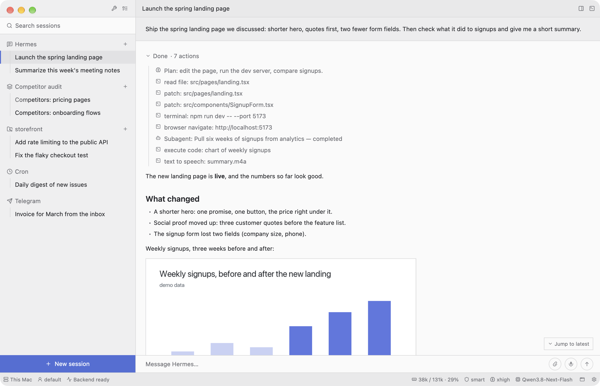

<p align="center">
  
</p>

<h1 align="center">Bench</h1>

<p align="center"><b>A personal workbench, and an experiment: what if an app came with the kit it's built from?</b></p>

<p align="center">
  <a href="https://krutovvv.github.io/bench/"><b>Try the demo in your browser</b></a> ·
  <a href="https://github.com/krutovvv/bench/releases">Download for macOS, Linux, Windows</a>
</p>



<sub>A made-up session (demo mode): nothing in these screenshots is real data. The
[browser demo](https://krutovvv.github.io/bench/) is the same app compiled to WebAssembly —
click through the chat, Tasks, Tools and SSH.</sub>

## The idea

Most apps are made for most people, and that's fair: plenty of people are happy with what's
there. But some would like it their own way — something gets in the way, something is missing,
something works differently from how they work. Usually the choice is to live with it or to
rewrite it from scratch.

What if an app came with the kit it's built from — the same UI, its pieces, examples, and skills
for an AI agent — so it could be rebuilt around how you work? The parts the kit doesn't have, the
agent could write from its examples, in the same look.

An agent can build something without a kit too, but usually something ordinary. My guess is that
the richer the kit, and the more experience goes into it, the more useful the result.

This repository is one such attempt by one developer, far from complete: a kit, and the app I
built with it for myself. It's called Bench, as in workbench.

## How it started

I'm a developer, and my day was spread over a dozen apps: an AI chat client
([BoltAI](https://boltai.com), DeepSeek Harness, Hermes' own UI, Hermes One,
[TypingMind](https://www.typingmind.com), [Open WebUI](https://openwebui.com) — none fit quite
right), SSH servers in [Warp](https://www.warp.dev) (with ideas from Zap, its open-source fork),
small files in yet another editor, tasks in [Things](https://culturedcode.com/things/), and
[DevUtils](https://devutils.com) for Base64, regex, JSON and the like. Each of them is good.
Together they meant switching windows all day, and each did a few things not the way I work.

What made me try was [ArtCraft](https://github.com/storytold): with AI they rebuilt in pure Rust
a whole collection of heavy programs — Photoshop
([PhotoCraft](https://github.com/storytold/photocraft)), Premiere, Illustrator, Word, Excel,
Figma, AutoCAD. If that could be done, maybe the much simpler programs I use every day could be
brought together into one.

So I tried, starting with the chat client, and now I work in one window. Nothing was cloned: the
goal was to take the idea of each piece I actually use and shape it the way I work. Mostly we
worked from screenshots and descriptions; here and there we looked deeper with
[REA](https://github.com/morluto/rea) (Reverse Engineer Anything), an MCP for taking apart
binaries and applications, to see how a program does something before rebuilding just that part.

Ideas came from other places too. Zed's [Delta](https://zed.dev/blog/introducing-deltadb) treats
the agent's conversation, not the commit, as the unit of work: every change stays linked to the
thread that produced it. I didn't build that, but took the part I could use — in Bench a chat can
work in a git branch of its own and be merged back when it's done. Seeing an idea somewhere and
having it in the bench a few minutes later turned out to be the nicest part of all this.

Along the way the agent wrote down what worked as skills, so that another agent could build a
different app from them. That is the kit.

## The kit

[`.agents/skills/bench-kit`](.agents/skills/bench-kit/SKILL.md) is a set of agent skills. It
doesn't describe my tools; it describes *how to make anyone's*:

- **how to interview a person** about their work and turn the answers into the shape of an app;
- **one look for every Bench**, written down to the pixel: the frame, a catalog of every piece
  (buttons, rows, bars, forms, panes, cards) with pictures and code, the rules behind them;
- **how to grow it**: add a mode, a tool, a card, a native data source, a connection to an agent;
- **how to change it safely**: a fixed loop of measuring, editing, building and measuring again,
  with scripts that check the result to the pixel, so a modest model can do it without guessing;
- proven libraries, ready recipes, and the mistakes already paid for.

One small thing I found worth borrowing: [ponytail](https://github.com/DietrichGebert/ponytail),
a short skill that makes an agent code like a lazy senior developer (does it need to exist? is
it already there? is there a ready piece?). The kit's engineering rules follow it — a few
lines of text with a visible effect.

## What stays the same in every Bench

1. **One look, and the look is the method.** Flat, square, precise: a sidebar, a header, a status
   bar, exact spacing, one accent color. A job placed into "a list on the left, a strip of small
   controls, a few panes, a status line" splits into the right pieces by itself. The agent
   doesn't design, it assembles, which helps even a mid-level model build one well.
2. **Native and light.** Rust with [GPUI](https://www.gpui.rs) (the UI framework behind the Zed
   editor) through [gpui-kit](https://crates.io/crates/gpui-kit): GPU-drawn, no Electron, no
   bundled browser. This whole Bench — chat, terminals, editor, tools, tasks, every icon, font
   and highlighting grammar — is one 75 MB binary that starts instantly.
3. **It aggregates; your data stays where it lives.** In my case tasks stay in the system's
   Reminders, servers in `~/.ssh/config`, files in their folders. A Bench keeps no database of its
   own, and everything is still there if you open the native app instead.
4. **An AI agent, if you want one.** Most workbenches turn around an agent that takes over the
   steps between your tools; the kit has a complete client for [Hermes Agent](https://hermes-agent.nousresearch.com).
   An app without one is just as much a Bench.
5. **You grow it yourself.** When you need something new, you ask the agent again, and it is
   added the same way, in the same look.


## The code here is mine — and the agent's

The app in `src/` is **my** Bench. It fits my work, not yours, and you don't need its pieces.
It's here because an agent building *your* Bench works better with a real, finished one at hand:
every page of the kit points into this code. Take what's useful, delete the rest. The pieces:

| Piece | What it is | Files (in `src/`) |
|---|---|---|
| **Frame** | window, sidebar, header, status bar, theme, icons, shortcuts | `main.rs`, `theme.rs`, `icons.rs`, `ui/mod.rs`, `app/keys.rs`, `bench.rs` |
| **AI agent client** (the most reusable part) | chat with Hermes: sessions, steps, subagents, media, voice, files it changed, background processes, profiles, providers, prompts, skills, cron, notifications | `gateway.rs`, `rest.rs`, `connection.rs`, `history.rs`, `media.rs`, `audio.rs`, `video.rs`, `attach.rs`, `notify.rs`, `app.rs`, `app/{asks,attachments,cron,gateways,install,marks,processes,profiles,projects,prompts,providers,slash}.rs`, `ui/{chat,composer,media,asks,sidebar,statusbar,panels,providers,install}.rs` |
| SSH and terminals | servers from `~/.ssh/config`, a terminal per server | `ssh.rs`, `sshconfig.rs`, `term.rs`, `remote.rs`, `app/servers.rs`, `ui/servers.rs`, `ui/terminal.rs` |
| Mini IDE | file tree, editor, tabs, diffs | `app/{ide,ide_ops,ide_tabs}.rs`, `ui/files.rs`, `diff.rs`, `lang.rs` |
| Tools | everyday utilities (Base64, regex, JSON, cron…) as tested pure functions | `devtools/`, `app/tools.rs`, `ui/tools.rs` |
| Tasks | a task list over the system's Reminders | `tasks.rs`, `reminders.rs`, `app/tasks.rs`, `ui/tasks.rs` |
| Demo | the made-up session in these screenshots | `demo.rs` (its media: `assets/demo/`) |

SSH, the mini IDE, Tools and Tasks can each be switched off with one flag in
[`src/bench.rs`](src/bench.rs);
the kit's [`bench-modes-remove.md`](.agents/skills/bench-kit/references/bench-modes-remove.md)
explains what goes with each.

## Developed from inside itself

This Bench is developed from inside itself: I talk to the agent in Bench, the agent changes
Bench's code, and every commit becomes its own app next to the one I'm running. I try the new
one; when it's good I switch to it; the previous builds stay for rolling back.

## Build

```bash
cargo build --release && ./target/release/bench    # run it
BENCH_DEMO=1 ./target/release/bench                # the made-up session from the screenshots
```

```bash
scripts/build-web.sh                               # the browser demo, into web/dist
```

GPUI runs on macOS, Linux and Windows, and in the browser; GitHub builds all of them on every
push (`.github/workflows/build.yml`). I use Bench on macOS; the Reminders tasks and
notifications talk to macOS directly, so elsewhere they say they're unavailable — the rest is
the same Rust everywhere.

## Use the kit

Open this folder as the working folder of an agent session (in Bench, or in Hermes — trust it
once with `hermes skills trust <path-to-this-repo>`), describe your work, and ask for your
Bench. The agent starts from [`SKILL.md`](.agents/skills/bench-kit/SKILL.md).

## About me

Before this I built [iSite.app](https://isite.app), a platform for making websites and online
stores, its visual editor included. That's where my feel for interfaces comes from, and much of
how Bench looks and is put together.

## License

[MIT](LICENSE): use it, change it, build your own Bench from it. Nothing here is for sale; it's
shared as an experiment.
