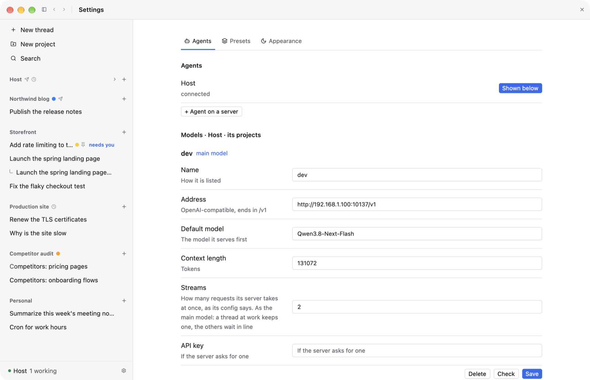
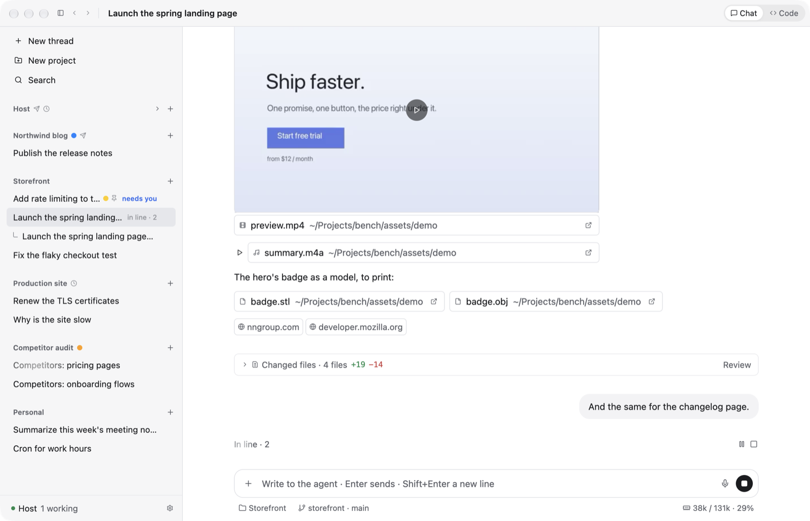
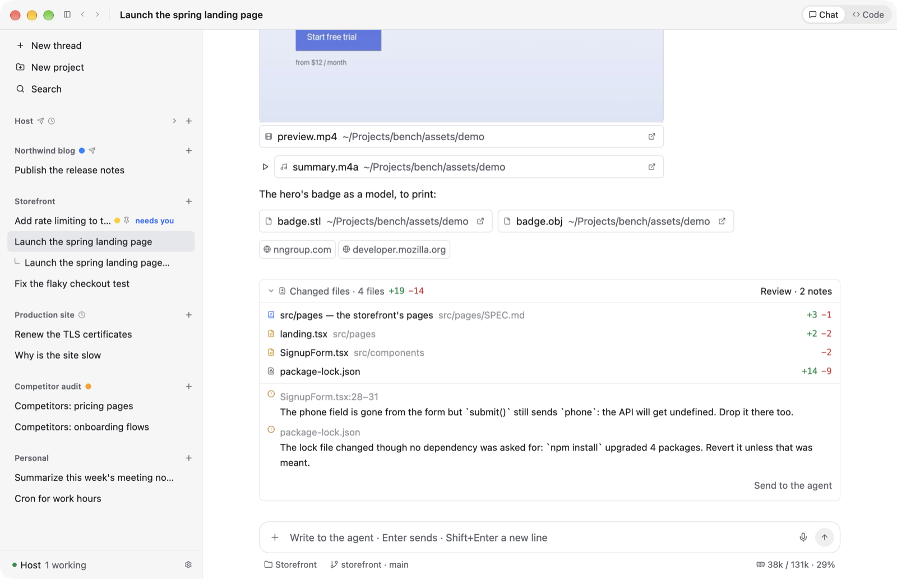
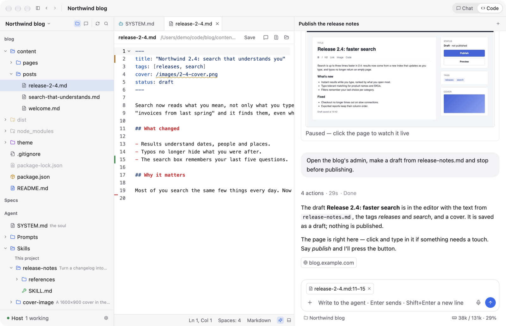

# Bench

A native desktop app for coding with an AI agent on a local LLM. Written in Rust with GPUI, with the
agent running on Pi Durable.

I built it for my own hardware and put the source here in case it helps someone. **Deep alpha, not a
product:** there is nothing to download. You take the code and change it.

*The pictures show made-up data. [The same demo runs in your browser](https://krutovvv.github.io/Bench/).*

## Is this for you?

**Maybe, if:**

- you run a model on your own machine, it is on the slow side, and you want more out of it;
- you want your own agent client and would rather change working code than start from zero;
- you are curious what a native agent app in Rust looks like from the inside.

**Probably not, if:**

- you want an app to install and just use;
- you work with a strong cloud model: most of this solves problems you don't have;
- you need something that works well on any setup. This one is fitted to mine.

## Why I made it

My model, a Qwen, writes about 80 tokens a second, 150 at best, and its server has two streams. If it
reasons at every step, a 50-step task takes several times longer than it has to. It also tends to
wander off along the way.

A stronger model doesn't need help with any of that, so nobody builds for it. Most clients are about
getting a subscription agent into your IDE. I wanted one fitted to my hardware, so I made it. Or an
agent did: I am a front-end developer and I don't write Rust.

On the same hardware, my tools got better by an order of magnitude, maybe two.

## What's in it

- **A small model helping the big one.** A fast evaluator checks every step: does this one need
  reasoning, is the agent still on course, is the answer really finished? A step that just reads a
  file goes without reasoning, and an agent that wanders gets told.
- **A limit on streams.** You say how many requests your model's server takes. A working thread keeps
  its stream and the others wait in line, so nobody loses their prompt cache.
- **Runs that survive.** Every step is kept on disk by Pi Durable, so a restart loses nothing.
- **A way to see what the agent did.** Changed files under each answer, an independent reviewer that
  leaves notes on exact lines, and a file editor with a tree and diffs. It is not an IDE: I use it to
  look at the code more than to write it.
- **A chat beside the editor.** Select some lines, send them to the agent, get just those changed. It
  is how we all worked a year ago. I rarely do now, but sometimes it is the right tool.
- **The usual things.** The agent asks you questions, keeps a plan and runs background processes.
  Projects live on your Mac or on a server over SSH. There is a terminal and a browser inside a
  thread, voice input, and a Telegram bot.

<table>
<tr>
<td></td>
<td></td>
</tr>
<tr>
<td></td>
<td></td>
</tr>
</table>

## Making it yours

The code is the point. Give the repository to your coding agent and describe what you need.
Everything is written down for it: [`AGENTS.md`](AGENTS.md), [skills](.agents/skills/), and a
`SPEC.md` beside each module. Bench itself is built that way: I talk to the agent inside Bench and it
changes Bench.

The look is plain macOS on purpose. It is familiar and has no character of its own, so it makes a good
blank to build on.

## Why Rust

I could have built this for the web, I know that world well. I just don't want that kind of UI, and
Electron makes me sick. I wanted something native, light and fast. Rust is hard on people, but models
write it just fine, and the speed stays. The UI framework, GPUI, comes from
[Zed](https://github.com/zed-industries/zed), the editor I used before agents.

What set me off was people rewriting heavy desktop software in Rust with agents: a hundred-odd
megabytes instead of gigabytes, the same shortcuts, and it flies. They are serious Rust developers and
I couldn't do what they do. But one client for my own needs turned out much simpler than I expected.
If you have been putting off something like this, it may be closer than you think.

## License

[MIT](LICENSE).
