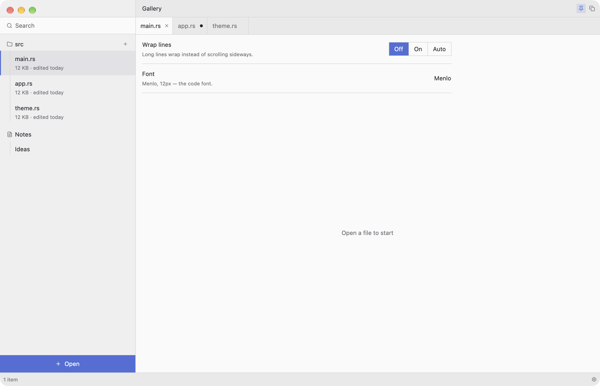

<p align="center">
  
</p>

<h1 align="center">Bench</h1>

<p align="center"><b>A personal workbench, and the kit an AI agent uses to build one for anyone.</b></p>



## The idea

Professional tools are built for everyone. An IDE, an SSH client, an AI chat, a task manager,
a converter website, a photo editor: each one serves millions of people a little. Every one of
us uses a small, specific part of each — the part our own work needs — and pays for the rest
with clutter, with switching windows, with copying things from one app into another.

Nobody makes software for one person. Nobody else knows that person's processes well enough,
and it would never pay off. But an AI agent can: it can listen to how someone works and build
exactly that, if it knows *how* to build it well.

**Bench is that: one window holding exactly the parts of your work you use, built for you by an
agent from your own description.** A writer's Bench, a sysadmin's Bench, an accountant's Bench
do different jobs. They all have the same shape.

## How it started

I'm a developer, and my day was spread over a dozen apps. I talk to my AI agent
([Hermes](https://hermes-agent.nousresearch.com)), and none of the clients I tried fit:
[BoltAI](https://boltai.com), DeepSeek Harness, Hermes' own UI, Hermes One,
[TypingMind](https://www.typingmind.com), [Open WebUI](https://openwebui.com). My servers
lived in [Warp](https://www.warp.dev), with ideas taken from Zap, its open-source fork that
adds a few things of its own; small files opened in yet another editor; I tracked my
tasks in [Things](https://culturedcode.com/things/) and reached for
[DevUtils](https://devutils.com) for Base64, regex, JSON, Unix time and the like. Each of them is
good. Together they meant switching windows all day, copying things from one into the next,
and using a small part of each.

The push came from [ArtCraft](https://thedieline.com/artcraft-launches-an-open-source-ai-powered-alternative-to-adobes-creative-cloud/):
a developer used Claude to write open-source Rust look-alikes of Adobe's apps — PhotoCraft
after Photoshop, FilmCraft after Premiere, and more
([Phoronix](https://www.phoronix.com/news/Photocraft-Filmcraft-AI)). If an AI can get that
far with programs of that size, then the much simpler programs one person uses every day can
certainly be brought together into one.

So this is that experiment. **Bench now holds, in one fast native window, the parts I used of
all of the above**: the chat with my agent, my SSH servers with their terminals (after Warp and
Zap, much simpler), a mini IDE for
the files the agent touches, a tools mode in place of DevUtils, and my tasks (moved from Things
into the system's Reminders, which the agents read and write too). Nothing had to be copied
exactly: the goal was never to clone a program, only to take the idea of each piece I actually
use and give it one shape. We worked from screenshots and descriptions. A disassembler MCP such
as [ReVa](https://github.com/cyberkaida/reverse-engineering-assistant) (Ghidra) could take
this further — studying how a program does something before rebuilding just that part — but
the simple tools here never needed it.

The interesting part turned out to be not the app but the way to make it: written down as
agent skills, it works for anyone's set of programs.

## The kit is the point

This repository holds a Bench, but what matters is the set of agent skills next to it:
[`.agents/skills/bench-kit`](.agents/skills/bench-kit/SKILL.md). The kit is universal. It
doesn't describe one person's tools; it describes *how to make anyone's*:

- **how to interview a person** about their work and turn the answers into the shape of an app;
- **one look for every Bench**, written down to the pixel: the frame, a catalog of every piece
  (buttons, rows, bars, forms, panes, cards) with pictures and code, the rules behind them;
- **how to grow it**: add a mode, a tool, a card, a native data source, a connection to the agent;
- **how to change it safely**: a fixed loop of measuring, editing, building, measuring again,
  with scripts that check the result to the pixel, so a modest model can do it without guessing;
- proven libraries, ready recipes and the mistakes already paid for.

Think of a 3D printer and its test boat, the "benchy": one model, printed in different sizes and
colors for different purposes, always recognisably the same. The kit is the printer.

## What every Bench keeps

1. **One look, and the look is the method.** Flat, square, precise: a sidebar, a header, a status
   bar, exact spacing, one accent color. A job placed into "a list on the left, a strip of small
   controls, a few panes, a status line" splits into the right pieces by itself. The agent
   doesn't design, it assembles, which is why even a mid-level model can build one well.
2. **An AI agent is built in.** Almost any personal workbench turns around an agent that takes
   over the steps between your tools. The kit uses [Hermes Agent](https://hermes-agent.nousresearch.com)
   and a complete client for it. An app without an agent is built only when that is what you ask for.
3. **It aggregates; your data stays where it lives.** Tasks stay in the system's Reminders,
   servers in `~/.ssh/config`, files in their folders. A Bench keeps no database of its own, and
   everything is still there if you open the native app instead.
4. **Exactly your subset, built as asked.** Not a replacement for a big product: the part you
   use, done simply, nothing that does nothing.
5. **You grow it yourself.** When you need something new, you ask the agent again, and it is
   added the same way, in the same look.

## A Bench that builds itself

This Bench is developed from inside itself: you talk to the agent in Bench, the agent changes
Bench's code, and every commit becomes its own app, `dist/Bench.<commit>.app`, next to the one
you're running. You try the new one; when it's good you move the Dock icon over; the previous
builds stay for rolling back.

## What's here

- `src/` — the reference Bench: Rust, [GPUI](https://www.gpui.rs) through
  [gpui-kit](https://crates.io/crates/gpui-kit) 0.8, macOS. A chat with Hermes (sessions, steps,
  media, files the agent changed, background processes, voice), SSH servers with terminals, a
  mini IDE, a tools mode, a task list over the system's Reminders.
- `.agents/skills/bench-kit/` — the kit: `SKILL.md` is the entry, `references/` the pages,
  `scripts/` the helpers (new app, screenshots of your own window, measuring, shipping),
  `templates/` a plain app frame and examples.

## Build

Needs macOS, Rust and, for the chat, [Hermes Agent](https://hermes-agent.nousresearch.com).

```bash
cargo build --release && ./target/release/bench           # run it
scripts/bundle-macos.sh                                    # dist/Bench.<commit>.app (commit first)
```

## Use the kit

Open this folder as the working folder of an agent session (in Bench, or in Hermes — trust it
once with `hermes skills trust <path-to-this-repo>`), describe your work, and ask for your Bench.
The agent starts from [`SKILL.md`](.agents/skills/bench-kit/SKILL.md). To start a new person's
Bench from this one: `.agents/skills/bench-kit/scripts/new-bench.sh <name>`.
